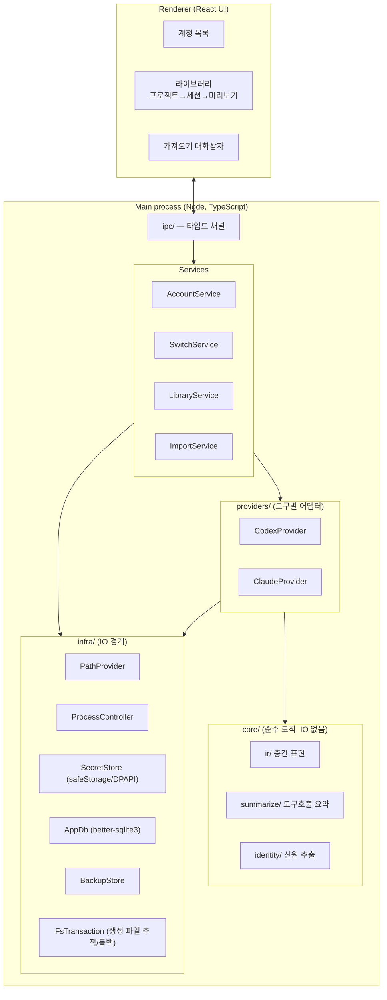
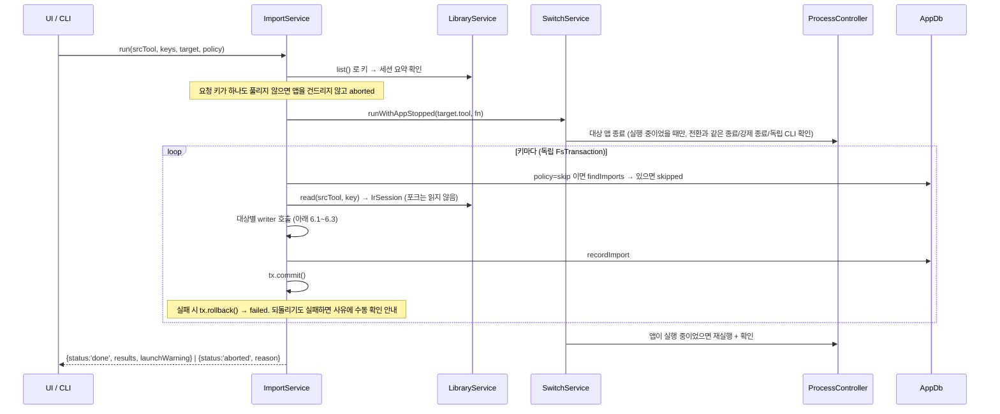

# AI Account Bridge — 아키텍처

- 작성일: 2026-09-23
- 요구사항/결정 배경: [design spec](superpowers/specs/2026-09-23-ai-account-bridge-design.md)
- 파일 포맷 정보는 2026-09-23 기준 실제 설치본(Codex `cli_version 0.150.x`, Claude Desktop)에서 **키 이름만** 관찰한 것이다. 값/토큰은 열람하지 않았다. 모든 항목은 Phase 0 검증 전까지 "관찰됨"이며 확정이 아니다.

---

## 1. 전체 구조



의존 방향: `Renderer → ipc → services → providers → core`, 그리고 `services/providers → infra`.
`core` 는 파일시스템/프로세스를 직접 만지지 않는다(순수 함수) → 단위 테스트가 쉬움.

## 2. 디렉터리 레이아웃 (소스)

```
ai-account-bridge/
├─ docs/
│  ├─ architecture.md                  ← 이 문서
│  ├─ superpowers/specs/…-design.md    ← 설계 문서
│  └─ verification/                    ← Phase 0 검증 기록 (V1~V10)
├─ src/
│  ├─ main/
│  │  ├─ index.ts                      ← Electron main 진입점
│  │  ├─ ipc/                          ← 채널 정의 + 핸들러 (zod 로 입력 검증)
│  │  ├─ services/
│  │  │  ├─ account-service.ts         ← 등록/목록/이름변경/삭제
│  │  │  ├─ switch-service.ts          ← 전환 오케스트레이션 + 롤백
│  │  │  ├─ library-service.ts         ← 조회 + 계정 귀속(태그)
│  │  │  └─ import-service.ts          ← 이관 오케스트레이션 + 이력
│  │  ├─ providers/
│  │  │  ├─ types.ts                   ← ToolProvider 인터페이스
│  │  │  ├─ codex/
│  │  │  │  ├─ paths.ts
│  │  │  │  ├─ auth.ts                 ← 인증 세트 읽기/쓰기, 신원
│  │  │  │  ├─ reader.ts               ← rollout JSONL → IR
│  │  │  │  ├─ writer.ts               ← IR → rollout JSONL
│  │  │  │  ├─ state-db.ts             ← state_5.sqlite 조회/등록
│  │  │  │  └─ schema.ts               ← zod 스키마 (관찰 기반)
│  │  │  └─ claude/
│  │  │     ├─ paths.ts                ← 프로젝트 폴더 인코딩 포함
│  │  │     ├─ auth.ts
│  │  │     ├─ reader.ts               ← 세션 JSONL → IR
│  │  │     ├─ writer.ts               ← IR → 세션 JSONL
│  │  │     ├─ desktop-index.ts        ← local_*.json 조회/생성/복사
│  │  │     └─ schema.ts
│  │  ├─ core/
│  │  │  ├─ ir.ts                      ← IR 타입
│  │  │  ├─ normalize.ts               ← 역할 병합, 이관 안내 블록 삽입
│  │  │  ├─ summarize.ts               ← 도구 호출 요약 (2KB 제한)
│  │  │  └─ identity.ts                ← JWT 디코드(서명검증 없음, 표시용)
│  │  └─ infra/
│  │     ├─ path-provider.ts           ← HOME/APPDATA/LOCALAPPDATA 주입
│  │     ├─ process-controller.ts      ← 앱 찾기/종료/실행
│  │     ├─ secret-store.ts
│  │     ├─ app-db.ts                  ← 자체 DB + 마이그레이션
│  │     ├─ backup-store.ts
│  │     └─ fs-transaction.ts
│  ├─ preload/                         ← contextBridge 로 ipc API 노출
│  └─ renderer/                        ← React UI
└─ test/
   ├─ fixtures/{codex,claude}/         ← 합성 픽스처만 (실데이터 금지)
   ├─ unit/
   └─ integration/                     ← 임시 HOME + 임시 SQLite
```

> 위 트리는 설계 시점의 스케치다. Plan 2/3 구현 위치: reader(조회) = `providers/{codex,claude}/sessions.ts`, 이관 writer = `providers/{codex,claude}/writer.ts`(Claude 는 인덱스 생성·포크 포함, Codex 는 `threads`/`session_index.jsonl` 쓰기 포함), IR → 대상 텍스트 렌더링·역할 병합·이관 안내 = `core/render.ts`(`normalize.ts`/`summarize.ts` 대신), 도구 호출 2KB 요약은 `core/ir.ts` 의 `truncate`, GUI 는 `gui/`(Tauri 창, RPC 백엔드 `src/rpc/` 는 사이드카), CLI 는 `src/cli/`.

## 3. 핵심 인터페이스

### 3.1 ToolProvider

두 도구의 차이를 이 인터페이스 뒤로 숨긴다. 서비스 계층은 `ToolId` 만 알고 도구별 파일 구조는 모른다.

```ts
type ToolId = 'codex' | 'claude';

interface Identity {
  tool: ToolId;
  accountId: string;          // codex: tokens.account_id / claude: oauthAccount.accountUuid
  orgId?: string;             // claude: organizationUuid
  email?: string;
  displayName?: string;
}

interface AuthBundle {        // 암호화 저장 단위. 값은 절대 로깅하지 않음 (Plan 1 구현 기준)
  tool: ToolId;
  files: { root: RootKey; relPath: string; data: string | null }[]; // data 는 base64, null = 파일 없음
  replaceDirs: { root: RootKey; relPath: string }[];                 // 적용 시 통째로 지우고 files 로 재구성할 폴더
  jsonKeys: { root: RootKey; relPath: string; key: string; value: unknown }[]; // JSON 최상위 키 하나만 교체 (예: ~/.claude.json 의 oauthAccount)
}

interface AppInfo {
  aumid: string;               // shell:AppsFolder 실행용
  packageDirMarker: string;    // 앱 프로세스 경로에 포함되는 문자열 (WindowsApps 패키지 경로)
  managedDirs: string[];       // 앱이 띄우는 하위 프로세스(내장 CLI 등) 경로
  cliNames: string[];          // 독립 실행 CLI 프로세스 이름
}

interface ToolProvider {
  id: ToolId;

  // 앱
  app: AppInfo;

  // 인증 — Plan 1 에서 `ToolAuthProvider` 로 구현 완료
  readCurrentAuth(): Promise<AuthBundle>;
  identityOf(bundle: AuthBundle): Identity;
  writeAuth(bundle: AuthBundle): Promise<void>;           // 호출 전 앱 종료 보장은 SwitchService 책임

  // 조회 (읽기 전용, 앱 실행 중 허용) — Plan 2 예정
  listProjects(): Promise<ProjectRef[]>;
  listSessions(filter?: { projectPath?: string }): Promise<SessionRef[]>;
  readSession(ref: SessionRef): Promise<IrSession>;

  // 쓰기 (앱 종료 상태 필수) — Plan 3 예정
  canWrite(): Promise<{ ok: true } | { ok: false; reason: string }>; // 스키마/버전 검사
  writeSession(session: IrSession, target: WriteTarget, tx: FsTransaction): Promise<SessionRef>;
  shareSession?(ref: SessionRef, to: Identity, tx: FsTransaction): Promise<SessionRef>; // claude A→B 인덱스 복사
}
```

### 3.2 중간 표현 (IR)

Plan 2(조회)에서 실제 구현된 형태는 다음과 같다 (`src/main/core/ir.ts`). `importNotice` 블록(이관 안내, 설계 D5)은 Plan 3(이관 writer)에서 추가되었다 — reader 는 만들지 않고, `core/render.ts` 의 `prepareForImport` 가 첫 user 메시지를 만들 때 쓴다.

```ts
interface IrToolBlock { kind: 'tool'; name: string; input: string; output?: string; isError?: boolean }
type IrBlock =
  | { kind: 'text'; text: string }
  | IrToolBlock
  | { kind: 'compactSummary'; text: string }    // 압축된 이전 대화
  | { kind: 'importNotice'; fromTool: ToolId; title?: string; sessionId: string; createdAt: string };  // 이관 안내(Plan 3)

interface IrMessage {
  role: 'user' | 'assistant';
  timestamp?: string;         // ISO-8601, 원본에 없으면 생략
  blocks: IrBlock[];
}

interface IrStats {
  droppedReasoning: number;   // 폐기된 reasoning/thinking
  droppedSystem: number;      // 폐기된 시스템/환경/주입 문맥
  droppedSidechain: number;   // 서브에이전트 대화(agent_message, isSidechain)
  unknownLines: number;       // 파싱 실패 또는 알 수 없는 줄 타입
  toolCalls: number;
}

interface IrSession {
  tool: ToolId;
  sessionId: string;
  title?: string;
  cwd?: string;
  model?: string;
  messages: IrMessage[];
  stats: IrStats;
}
```

writer(Plan 3)는 `tool` / `compactSummary` / `importNotice` 블록을 `blockToText` 로 대상 도구의 **텍스트**로 렌더링하고, `prepareForImport` 가 빈 메시지 제거 → 같은 역할 연속 병합 → 이관 안내를 담은 user 메시지로 시작하도록 정규화한 `PreparedMessage[]` 를 만든다(설계 D5, §5).

`IrBuilder`(reader 가 원본을 한 줄씩 읽으며 IR 을 쌓는 도우미)는 같은 역할의 연속 메시지를 하나로 합치고(`text`), 도구 호출(`toolCall`)과 결과(`toolOutput`)를 `id` 로 짝짓는다. Claude 세션 파일은 **`tool_result` 가 그 짝인 `tool_use` 보다 앞줄에 나오는 경우가 있다**(Task 1 구현 시 실측) — 이 경우를 위해 `toolOutput` 이 아직 보지 못한 `toolCall` 의 결과를 임시로 들고 있다가(`pendingOutputs`), 나중에 같은 id 로 `toolCall` 이 오면 즉시 짝짓는다.

### 3.3 인프라 인터페이스

```ts
interface PathProvider {        // 테스트에서는 임시 폴더로 교체
  home: string;                 // %USERPROFILE%
  appData: string;              // %APPDATA%
  localAppData: string;         // %LOCALAPPDATA%
  appDataDir: string;           // 본 앱 저장소 = %APPDATA%\ai-account-bridge
}

interface ProcessController {   // Plan 1 구현. 타임아웃/사용자 확인/autoKill 여부는 SwitchService 가 list() 를 폴링하며 처리
  list(): Promise<{ pid: number; name: string; path: string }[]>;
  closeGracefully(pids: number[]): Promise<void>;  // 메인 창 닫기 요청 (트레이로 숨을 수 있음)
  kill(pids: number[]): Promise<void>;
  launch(aumid: string): Promise<void>;   // explorer.exe shell:AppsFolder\<AUMID>
}

class FsTransaction {            // 이관 1건 = 트랜잭션 1개 (Plan 3 구현)
  constructor(backupDir: string);
  createFile(path: string, data: string | Buffer): Promise<void>;   // 이미 있으면 오류. 임시 파일에 쓴 뒤 rename(원자적), 성공하면 생성 목록에 추가
  backupThenModify(path: string, fn: () => Promise<void>): Promise<void>;  // 원본 바이트를 메모리+backupDir 에 보관한 뒤 fn 으로 수정
  onRollback(fn: () => Promise<void> | void): void;   // 파일로 표현할 수 없는 되돌리기(예: DB 행 DELETE) 등록
  rollback(): Promise<void>;    // 등록 역순: 생성 파일 삭제 · 수정 파일 원복 · 보정 작업 실행. 실패한 항목은 남겨 재시도 가능, 하나라도 실패하면 오류
  commit(): void;               // 추적 목록을 비운다
}
```

## 4. 저장소 (본 앱 데이터)

```
%APPDATA%\ai-account-bridge\
├─ app.db                         ← 자체 SQLite
├─ profiles\<tool>\<accountKey>.bin        ← DPAPI(CurrentUser)로 암호화된 AuthBundle (Plan 1: PowerShell, Plan 4: safeStorage)
├─ profiles\<tool>\<accountKey>.prev.bin   ← 직전 세대 스냅샷(한 세대만 보관) — 갱신 때 새 파일을 쓰기 전에 기존 `.bin` 을 여기로 복사
├─ backups\<tool>\<timestamp>-<random>.bin ← 전환/복원 직전 인증 파일 세트의 암호화 백업 (도구별 최근 20개, `restore` 대상 파일은 정리 대상에서 제외)
└─ logs\                          ← 토큰/대화 원문 기록 금지
```

`profiles\<tool>\*.bin`/`*.prev.bin` 과 `backups\<tool>\*.bin` 은 같은 `AuthBundle` 직렬화 포맷을 쓴다 — `restore <tool> <경로>` 로 둘 다 복원할 수 있다.

`app.db` 스키마:

```sql
CREATE TABLE accounts (
  id            INTEGER PRIMARY KEY,
  tool          TEXT NOT NULL,            -- 'codex' | 'claude'
  account_id    TEXT NOT NULL,
  org_id        TEXT NOT NULL DEFAULT '',   -- NULL 이면 UNIQUE 가 동작하지 않으므로 '' 사용
  display_name  TEXT,
  email         TEXT,
  label         TEXT NOT NULL,            -- 사용자 지정 이름
  snapshot_path TEXT NOT NULL,
  snapshot_at   TEXT NOT NULL,
  status        TEXT NOT NULL DEFAULT 'ok', -- 'ok' | 'needs_relogin'
  UNIQUE (tool, account_id, org_id),
  UNIQUE (tool, label)
);

CREATE TABLE switch_events (             -- Codex 세션 계정 태그의 근거
  id          INTEGER PRIMARY KEY,
  tool        TEXT NOT NULL,
  account_id  INTEGER REFERENCES accounts(id),
  switched_at TEXT NOT NULL,
  result      TEXT NOT NULL              -- 'ok' | 'rolled_back'
);

CREATE TABLE session_tags (              -- 수동 태그 재지정 (자동 판정보다 우선)
  tool       TEXT NOT NULL,
  session_id TEXT NOT NULL,
  account_id INTEGER REFERENCES accounts(id),
  PRIMARY KEY (tool, session_id)
);

CREATE TABLE imports (                   -- 마이그레이션 2 (Plan 3)
  id               INTEGER PRIMARY KEY,
  src_tool         TEXT NOT NULL,
  src_key          TEXT NOT NULL,          -- 라이브러리 세션 키 (예: 'claude:code:local_<id>')
  dst_tool         TEXT NOT NULL,
  dst_account_key  TEXT NOT NULL,          -- claude: '<accountUuid>/<orgUuid>', codex: ''
  dst_session_id   TEXT NOT NULL,          -- 새 cliSessionId / threadId
  imported_at      TEXT NOT NULL,
  stats_json       TEXT NOT NULL           -- IR stats (포크는 '{}')
);
CREATE INDEX imports_src ON imports (src_tool, src_key, dst_tool, dst_account_key);
```

`imports` 는 중복 이관 판정(`findImports` — 같은 원본·대상 도구·대상 계정에 이력이 있고 정책이 `skip` 이면 건너뜀), 이관 이력 조회(RPC `importHistory` → `findImportsBySource`), 라이브러리 목록의 `이관됨` 배지(`listImportedSrcKeys` → RPC `libraryList` 의 `imported` 키 목록)에 쓰인다. 대상 계정을 계정 행(`accounts.id`)이 아니라 계정/조직 UUID 문자열로 저장하므로 등록되지 않은 계정 폴더로의 이관도 기록할 수 있고, 계정을 삭제해도 이력이 남는다.

Codex 세션 계정 판정: `session_tags` 우선 → 없으면 `threads.created_at` 이전 가장 최근의 성공한 `switch_events.account_id` → 없으면 "미분류".

계정 삭제(`AccountService.remove` / RPC `delete` / CLI `delete`)는 `accounts` 행 하나만 지운다 — `switch_events.account_id` 는 (FK 가 `ON DELETE` 를 정하지 않으므로) 삭제 전에 먼저 `NULL` 로 갱신해 기록 자체는 남긴다. 같은 트랜잭션으로 처리한다. 계정 이름 변경(`rename`)은 `label` 만 바꾸고, 같은 도구에서 그 라벨이 이미 다른 계정에 쓰이고 있으면 `upsertAccount` 와 같은 문구로 거부한다. 두 작업 모두 앱의 실제 로그인 상태나 스냅샷 파일이 아닌 이 테이블(과 삭제 시 `profiles\<tool>\<key>.bin`/`.prev.bin`)만 건드린다.

## 5. 외부 파일 포맷 레퍼런스 (관찰 기반)

### 5.1 GPT / Codex

앱: 시작 메뉴 이름 "ChatGPT", 패키지 `OpenAI.Codex_2p2nqsd0c76g0`, AUMID `OpenAI.Codex_2p2nqsd0c76g0!App`.

| 용도 | 경로 |
|---|---|
| 코드 인증 | `%USERPROFILE%\.codex\auth.json` — 키: `auth_mode`, `OPENAI_API_KEY`, `tokens.{id_token, access_token, refresh_token, account_id}`, `last_refresh` |
| 채팅 쪽 라이브 웹 프로필 (`--with-app-profile`, V2 검증 대상) | `%LOCALAPPDATA%\Packages\OpenAI.Codex_2p2nqsd0c76g0\LocalCache\Roaming\Codex\web\Codex\` — `Local State`, `Default\Network\`, `Default\Local Storage\`. 루트 바로 아래 `Network`/`Local State`/`Local Storage` 는 4월 이후 갱신되지 않으며, 실제 로그인 세션은 `web\Codex\` 아래에 있다 |
| 세션 원본 | `%USERPROFILE%\.codex\sessions\YYYY\MM\DD\rollout-<ISO시각>-<threadId>[_<id>].jsonl` |
| 세션 목록 인덱스 | `%USERPROFILE%\.codex\state_5.sqlite` |
| 대화 투영 캐시 | `%USERPROFILE%\.codex\thread_history_1.sqlite` — 앱이 rollout 의 `event_msg/item_completed` 로 `thread_items`/`thread_turns` 를 만들고, 읽은 위치를 `thread_history_projection_state` 에 기록해 다시 읽지 않는다 (V7). 이관은 이 파일을 직접 쓰지 않는다 |
| 이름 인덱스 | `%USERPROFILE%\.codex\session_index.jsonl` — `{id, thread_name, updated_at}` |
| 프로젝트 지침 | 작업 폴더의 `AGENTS.md` |

**경로 관찰 (2026-09-28, Plan 2 구현 중 실측):** `%USERPROFILE%\.codex` 는 실제로는 `C:\codex_home` 으로의 **정션(junction)** 이다. `threads.rollout_path`/`cwd` 컬럼 값에는 `\\?\C:\…` 긴 경로(long path) 접두어가 그대로 들어 있어, 다른 곳에서 얻은 경로(예: 프로젝트 루트)와 문자열로 직접 비교하면 항상 불일치한다 → 비교 전에 `normalizeWinPath`(`src/main/core/win-path.ts`)로 `\\?\` 접두어와 끝 구분자를 제거한다.

`threads.source` 컬럼은 두 가지 형태를 갖는다: 단순 문자열(`vscode` 등)이거나, 서브에이전트 스레드일 경우 `{"subagent":{"thread_spawn":{"parent_thread_id":"<부모 threadId>"}}}` 형태의 JSON 문자열. `listCodexSessions` 는 이를 파싱해 서브에이전트를 `kind: 'subagent'` + `parentId` 로 표시하고, 조회 화면은 기본적으로 숨긴다("서브에이전트 포함" 체크박스로만 노출).

사용자 메시지(role=user)의 `content` 배열에는 실제 프롬프트와 **주입 문맥**(`<environment_context>`, `<user_instructions>`, `# AGENTS.md instructions`, `<permissions instructions>`, `<collaboration_mode>` 로 시작하는 블록)이 **같은 메시지의 서로 다른 content 항목**으로 섞여 들어온다. 필터는 메시지 단위가 아니라 **content 항목 단위**로 동작해 주입 문맥 항목만 제거하고 나머지(실제 프롬프트) 항목은 그대로 합친다(`readCodexSession`, `INJECTED` 정규식).

`state_5.sqlite` 주요 테이블:

| 테이블 | 컬럼 (관찰) |
|---|---|
| `threads` | `id, rollout_path, created_at, updated_at, source, model_provider, cwd, title, sandbox_policy, approval_mode, tokens_used, has_user_event, archived, archived_at, git_sha, git_branch, git_origin_url, cli_version, first_use…` |
| `projects` | `id, name, metadata, position, created_at_ms, updated_at_ms` |
| `project_roots` | `project_id, position, path` |
| `thread_spawn_edges` | `parent_thread_id, child_thread_id, status` (서브에이전트) |

rollout JSONL 줄 타입 (`{timestamp, type, payload}` 공통 봉투 — 최신 `history_mode:'paginated'` 는 봉투에 `ordinal` 이 더 붙는다. reader 는 둘 다 읽는다):

| `type` / `payload.type` | 의미 | 변환 |
|---|---|---|
| `session_meta` | `session_id, id, timestamp, cwd, originator, cli_version, source, model_provider, base_instructions, …` | 메타데이터 → IR `source`, `cwd` |
| `turn_context` | 턴별 `cwd, model, sandbox_policy …` | `model` 만 사용 |
| `response_item` / `message` role=`user` | `content[].type = input_text` | 텍스트 |
| `response_item` / `message` role=`assistant` | `content[].type = output_text`, `phase` | 텍스트 |
| `response_item` / `message` role=`developer` | 지침/환경 | 폐기 |
| `response_item` / `reasoning` | `summary[], encrypted_content` | 폐기 |
| `response_item` / `custom_tool_call` + `custom_tool_call_output` | `call_id, name, input` / `output[]` | tool 블록 |
| `response_item` / `function_call` + `function_call_output` | `call_id, name, namespace, arguments` / `output` | tool 블록 (`output` 이 문자열이 아니라 `{type:'input_text',text}[]` 배열일 수 있음 — `outputText` 헬퍼가 둘 다 처리) |
| `response_item` / `web_search_call` | `call_id`/`id`, `action` | tool 블록 (`web_search`, 결과 없이 호출만 있는 경우가 있음) |
| `response_item` / `tool_search_call` + `tool_search_output` | `call_id, arguments` / `tools` | tool 블록 |
| `response_item` / `agent_message` | 서브에이전트 통신 | 요약 한 줄 |
| `compacted` | `message, replacement_history[]` | compactSummary |
| `event_msg` / `*` (task_started, task_complete, item_completed, token_count …) | UI 이벤트 | reader 는 무시. **writer 는 `task_started`/`task_complete`/`item_completed` 를 쓴다**(아래 쓰기 형식) |
| `world_state`, `token_usage_record`, `inter_agent_communication_metadata` | 상태/통계 | 무시 |

**쓰기 형식 (Plan 3 `codex/writer.ts`, V7 로 실기기 검증):**

`rollout-<로컬시각 YYYY-MM-DDTHH-mm-ss>-<threadId>.jsonl` (threadId 는 UUID v7) 을 `sessions\YYYY\MM\DD\` 에 새로 만든다. 모든 줄은 `{ordinal, timestamp, type, payload}` 봉투이고 `ordinal` 은 0부터 줄마다 1씩 늘어난다.

| 줄 | 내용 |
|---|---|
| `session_meta` | 템플릿 rollout 의 첫 `session_meta` 를 복제(`base_instructions, dynamic_tools, originator, cli_version, model_provider` 유지) → `id`/`session_id` = 새 threadId, `timestamp`, `cwd`(`\\?\` 접두어 포함) 교체, `history_mode:'paginated'`, `context_window.window_id` 새로 발급, `git` 제거 |
| `turn_context` | 템플릿의 첫 `turn_context` 를 복제 — 템플릿 cwd(`workspace_roots`, `sandbox_policy` 등 어디에 있든)를 새 cwd 로 치환, `turn_id`/`root_turn_id` = 첫 턴 id, `comp_hash` 제거. 템플릿에 없으면 생략 |
| 턴 (user 메시지마다) | `event_msg/task_started {turn_id, started_at}` → `response_item/message` role=user(`input_text`) → `event_msg/item_completed` (`item.type:'UserMessage'`, `content:[{type:'text', text, text_elements:[]}]`) → 뒤따르는 assistant 메시지마다 `response_item/message`(`output_text`) + `item_completed`(`AgentMessage`, `content:[{type:'Text', text}]`, 마지막만 `phase:'final_answer'` 나머지 `'commentary'`) → `event_msg/task_complete {turn_id, started_at, completed_at, duration_ms, time_to_first_token_ms:0, last_agent_message}` |

메시지의 `internal_chat_message_metadata_passthrough` 는 `{turn_id, create_time, content_item_kinds:['text']}` 이다. **`item_completed` 가 없으면 앱의 히스토리 투영이 비어 대화가 빈 화면으로 보인다.** 시각 단위(실제 rollout 값 기준): `started_at`/`completed_at` = epoch **초** 정수, `create_time` = **초** 실수, `completed_at_ms`/`duration_ms`/`time_to_first_token_ms` = **밀리초** 정수 — 문자열이면 앱이 그 줄을 건너뛴다(V7 시도 2). 템플릿 cwd 치환은 대소문자를 무시하고, 일치 지점 뒤가 경로 구분자(JSON 이스케이프된 `\\`, `/`)·`"`·문자열 끝일 때만 바꿔 `C:\work` 가 `C:\work-backup` 을 건드리지 않는다.

`threads` 행은 템플릿 행(`source='vscode'` 중 cwd 가 같은 행 우선, 없으면 `updated_at` 이 가장 최근인 행)을 복제해서 만든다. 템플릿에 없는 컬럼은 추가하지 않고, 테이블에 없는 컬럼은 INSERT 에서 제외한다.

| 컬럼 | 값 |
|---|---|
| `id` | 새 threadId |
| `rollout_path` | 접두어 **없는** 경로 (실제 DB 관찰) |
| `cwd` | `\\?\<cwd>` (접두어 포함) |
| `title`, `name` | `[Claude] 원제목` |
| `preview`, `first_user_message` | 첫 메시지(이관 안내 포함) 앞 200자 |
| `created_at`/`updated_at`/`recency_at` (초), `*_ms` (밀리초) | 현재 시각 |
| `has_user_event`, `archived`, `tokens_used` | `1`, `0`, `0` |
| `history_mode`, `thread_source`, `source` | `paginated`, `user`, `vscode` |
| `sandbox_policy` | 템플릿 값의 cwd 를 새 cwd 로 치환 |
| `project_id` | cwd 를 포함하는 가장 깊은 `project_roots` 의 프로젝트(없으면 NULL). 앱은 cwd 가 프로젝트 루트와 같으면 `.codex-global-state.json` 을 고치지 않아도 그 프로젝트 아래에 보여준다(V7) |

`session_index.jsonl` 에는 `{id, thread_name, updated_at}` 한 줄을 덧붙인다(`updated_at` 은 ISO 문자열, 기존 파일이 있어야 하며 수정 전에 백업).

### 5.2 Claude

앱: 패키지 `Claude_pzs8sxrjxfjjc`, AUMID `Claude_pzs8sxrjxfjjc!Claude`. Electron 프로필은 `%APPDATA%\Claude\`.

| 용도 | 경로 |
|---|---|
| 코드 인증 | `%USERPROFILE%\.claude\.credentials.json` — 키: `claudeAiOauth.{accessToken, refreshToken, expiresAt, scopes, subscriptionType, rateLimitTier}`, `organizationUuid`, `mcpOAuth.*` |
| 계정 신원 | `%USERPROFILE%\.claude.json` → `oauthAccount.{accountUuid, emailAddress, organizationUuid, organizationName, displayName…}` (파일의 **다른 키는 건드리지 않고** 이 키만 교체) |
| Desktop 토큰 캐시 (기본 범위에 포함) | `%APPDATA%\Claude\config.json` → `oauth:tokenCache`, `oauth:tokenCacheV2` (둘 다 불투명한 문자열, 값은 그대로 복사), `lastKnownAccountUuid`. 다른 키는 보존, tab 들여쓰기로 저장된 원본을 2-space JSON 으로 다시 쓴다(Desktop 이 다음 저장 때 자기 형식으로 되돌림) |
| Desktop 쿠키/프로필 (`--with-app-profile`, V3 검증 대상) | `%APPDATA%\Claude\Network\Cookies`, `Local State`, `Local Storage\` |
| 세션 원본 | `%USERPROFILE%\.claude\projects\<인코딩된 cwd>\<cliSessionId>.jsonl` |
| Desktop Code 세션 인덱스 | `%APPDATA%\Claude\claude-code-sessions\<accountUuid>\<organizationUuid>\local_<id>.json` |
| Desktop Cowork 세션 | `%APPDATA%\Claude\local-agent-mode-sessions\<accountUuid>\<organizationUuid>\local_<id>\` (`.claude\`, `outputs\`, `audit.jsonl`) — V8 |
| 프로젝트 지침 | 작업 폴더의 `CLAUDE.md` |

**Desktop 인덱스 폴더 = `<accountUuid>\<organizationUuid>`** 는 실제로 확인했다 (`oauthAccount.accountUuid` 와 `.credentials.json` 의 `organizationUuid` 가 폴더명과 일치). → Claude 세션의 계정 귀속은 폴더로 결정 가능.

**계정 교차 검증**: `identityOf` 는 `oauthAccount.accountUuid` 를 신원으로 쓰되, `config.json` 의 `lastKnownAccountUuid` 가 존재하고 `accountUuid` 와 다르면 `계정 정보 불일치` 오류를 던진다(Desktop 에서 계정을 바꿨지만 `~/.claude.json` 이 아직 갱신되지 않은 상태). 이 오류는 "로그인 안 됨"(`NotLoggedInError`) 이 아닌 일반 `Error` 이므로, 호출자가 로그아웃과 혼동해 조용히 넘어가지 않는다 — `SwitchService` 는 이 오류를 그대로 다시 던져 전환을 취소한다(§7).

**Cowork 구조 (V8, 2026-09-28 실측 — 통과):** 인덱스 `local-agent-mode-sessions\<accountUuid>\<organizationUuid>\local_<id>.json` 의 주요 키는 `sessionId, cliSessionId, cwd(/sessions/<name> 형태), title, createdAt, lastActivityAt, isArchived, userSelectedFolders, emailAddress, accountName, model …` 로 Code 인덱스와 거의 같다. 본문은 같은 이름의 하위 폴더 안 `local_<id>\.claude\projects\<enc>\<cliSessionId>.jsonl` 이며, **줄 형식이 Claude Code 세션 JSONL 과 동일**해서 별도 파서 없이 `readClaudeSession` 을 그대로 재사용한다. 조회에서는 Cowork 세션을 작업 폴더 기준이 아니라 `Cowork 세션` 이라는 별도 프로젝트 그룹으로 묶는다.

프로젝트 폴더 인코딩(관찰): 영숫자가 아닌 문자를 `-` 로 치환.
예: `C:\Users\me\Desktop\work\frontend-starter` → `C--Users-me-Desktop-work-frontend-starter`.

**폴더 인코딩 예외 (V10, 2026-09-28 실측 — 11/11 파일 일치, 예외 2건):**
1. 세션 도중 작업 폴더를 옮기면, 폴더명은 최초 인코딩 그대로인데 파일 안 마지막 `cwd` 는 새 경로를 가리킨다.
2. SSH 원격 세션은 폴더명이 인코딩된 경로가 아니라 `ssh-<uuid>` 형태.

→ 그래서 조회 시 그룹은 **폴더명이 아니라 파일 안에서 관찰한 마지막 `cwd`** 로 묶고(`listClaudeSessions` 가 각 줄의 `cwd` 를 덮어쓰며 진행), `ssh-*` 폴더는 `remote: true` 로 표시해 "원격: `<cwd>`" 프로젝트로 분리한다. 인코딩 규칙 자체(문자 치환)는 Plan 3 의 writer 가 새 세션 파일을 만들 때 쓴다.

Desktop 인덱스 `local_<id>.json` 주요 키(관찰):
`sessionId, cliSessionId, cwd, originCwd, createdAt, lastActivityAt, lastFocusedAt, model, effort, isArchived, title, titleSource, permissionMode, completedTurns, …`
→ 생성 시 필수 최소 세트는 V6 에서 확정(대기). 구현된 전략은 **같은 계정 폴더에서 가장 최근에 수정된(파싱 가능한) `local_*.json` 을 템플릿으로 복제한 뒤 식별자/경로/제목/시각만 교체하고, 템플릿 세션에 묶인 필드는 제거**하는 것이다.

**쓰기 형식 (Plan 3 `claude/writer.ts`):**

- 전사 `~\.claude\projects\<enc(cwd)>\<새 cliSessionId>.jsonl` (`enc` = `normalizeWinPath` 후 영숫자 외 문자를 `-` 로 치환, V10). 줄마다 `parentUuid`(첫 줄 null, 이후 직전 `uuid`), `isSidechain:false`, `uuid`, `timestamp`(ISO), `userType:'external'`, `entrypoint:'claude-desktop'`, `cwd`, `sessionId`, `version`(이 기기 최신 세션 줄의 값, 없으면 `2.1.0`), `gitBranch:''`. user 는 `message:{role, content:string}`, assistant 는 `message:{model, id:'msg_imported_…', type:'message', role, content:[{type:'text',text}], stop_reason:'end_turn', stop_sequence:null, usage:{input_tokens:0, output_tokens:0}}` (`model` 은 원본 모델, 없으면 `imported`). 마지막에 `{type:'custom-title', customTitle:'[Codex] 원제목', sessionId}`.
- 인덱스 `%APPDATA%\Claude\claude-code-sessions\<acct>\<org>\local_<새 uuid>.json` — 템플릿 깊은 복사 후 `sessionId(local_…), cliSessionId, cwd, originCwd, title, titleSource:'user', createdAt/lastActivityAt/lastFocusedAt`(현재 시각 ms, 템플릿이 문자열이면 문자열), `isArchived:false, completedTurns`(assistant 메시지 수), `permissionMode:'default'`, `model` 을 교체한다(템플릿에 있는 키만).
- **인덱스에서 항상 제거하는 필드** — 템플릿(또는 포크의 원본) 세션의 권한·연결·대화에 묶여 있어 새 세션이 물려받으면 안 되는 값: 권한/승인 상태 `sessionPermissionUpdates, alwaysAllowedReasons, bypassChosenInApp, chromePermissionMode, cuAllowedApps, cuGrantFlags, autoChosenInApp` (허용해 둔 권한이 새 세션에 그대로 따라가지 않도록 — `permissionMode` 도 `default`), MCP 설정 `enabledMcpTools, remoteMcpServersConfig`, 원격/SSH `sshConfig, sshRemoteProcessId, sshRemoteTranscriptPath`, 오류·전사 상태 `error, errorAt, transcriptUnavailable` (새 세션이 오류/기록 없음으로 표시되지 않게), 템플릿 대화 참조 `lastAssistantUuid, forkedFromSessionId, planPath, scratchPromptRecents, spawnSeed, promptAppendSnapshot, toolSurfaceSnapshot, titleTurn, writtenBranches, sourceBranch, publishedArtifacts, initialMessage, systemPrompt`.
- **포크(Claude A → B)** 는 위 인덱스 빌더를 원본 인덱스에 그대로 적용하고(`cwd`/`title`/`completedTurns` 는 원본 값 유지), 전사는 줄 단위 복사에서 `sessionId` 만 새 `cliSessionId` 로 바꿔 원본과 같은 프로젝트 폴더에 새 파일로 둔다. 한 전사를 두 계정이 함께 쓰면 두 계정의 대화가 섞이므로 공유하지 않는다(설계 D14).

**인덱스 관찰(Plan 2 구현 중)**: `cliSessionId` 가 빈 인덱스 항목이 존재한다 — 이 경우 조회는 인덱스 자체의 `sessionId`(파일명)를 세션 ID 로 대신 써서 다른 세션과 키가 충돌하지 않게 한다(`fromIndex` 의 `fallbackId`).

세션 JSONL 줄 타입:

| `type` | 주요 키 | 변환 |
|---|---|---|
| `user` (content 문자열 또는 `text` 블록) | `uuid, parentUuid, sessionId, cwd, gitBranch, version, timestamp, message{role, content}, isSidechain, userType, entrypoint` | 텍스트 |
| `user` (`tool_result` 블록) | + `toolUseResult`, `sourceToolAssistantUUID` | 직전 tool 블록의 output — **단, 파일 안에서 `tool_result` 가 그 짝인 `tool_use` 보다 먼저 나오는 경우가 있어**(관찰) `IrBuilder` 가 순서 무관하게 id 로 짝짓는다(§3.2) |
| `assistant` (`text`) | + `requestId`, `message{role, content, model…}` | 텍스트 |
| `assistant` (`tool_use`) | | tool 블록 |
| `assistant` (`thinking`) | | 폐기 |
| `system`, `attachment`, `queue-operation`, `last-prompt`, `mode`, `custom-title`, `agent-name`, `file-history-snapshot` … | 부가 정보 | 무시 (`custom-title` 은 제목으로 사용) |
| `isSidechain: true` 인 줄 | 서브에이전트 | 요약 한 줄 |
| `user` 텍스트가 `<command-name>`, `<command-message>`, `<command-args>`, `<local-command-stdout/stderr>`, `<system-reminder>` 로 시작 | 슬래시 명령 실행 시 Claude Code 가 끼워 넣는 합성 텍스트(관찰) — 실제 사용자 발화가 아님 | system 으로 취급해 폐기 |

**대화 기록 없음(관찰, Plan 2 구현 중)**: 인덱스에는 있지만 `~\.claude\projects\` 아래 원본 JSONL 파일이 없는 세션이 실제 환경에서 다수(약 34개) 관찰됐다 — Claude Code 의 30일 지난 로컬 대화 자동 정리로 추정. 조회는 이런 세션을 배지 "대화 기록 없음"으로 표시하고 미리보기를 막으며, 이관(Plan 3) 대상에서도 제외한다(§4.3).

## 6. 이관 경로별 시퀀스

### 6.0 공통 흐름 (`ImportService.run`)



- `runWithAppStopped` 는 전환과 같은 동시 실행 방지(`inFlight` — "다른 전환이 진행 중입니다")·진행 이벤트를 쓴다. `fn` 이 던지면 `aborted` 로 바꾸되 앱은 재실행한다. 항목별 실패는 예외가 아니라 `results` 안의 `failed` 로 남으므로 전체 상태는 `done` 이다.
- RPC `importSessions` 는 잠금(`withLock`) 아래에서 실행되며 앱 프로필 범위와 무관하게 provider 를 만든다. CLI `import` 는 `autoKill` 로 같은 서비스를 호출한다.
- 작업 폴더는 원본 세션의 `cwd` 를 쓰되, Cowork 세션을 Codex 로 보낼 때는 인덱스의 `userSelectedFolders[0]`(`hostFolder`) 를 쓴다(Cowork 의 `cwd` 는 `/sessions/…` 가상 경로). 없으면 그 항목은 실패한다.
- 대화 기록이 없는 세션, 알 수 없는 키, Claude 계정 간 공유의 대상이 Code 세션이 아닌 경우도 항목별 실패다.

### 6.1 Codex → Claude

1. `LibraryService.read` → `IrSession`, `prepareForImport` 로 정규화(이관 안내 삽입, 역할 병합).
2. 대상 계정 폴더 `claude-code-sessions\<acct>\<org>\` 에서 템플릿 인덱스 선택(없으면 "대상 계정에서 Code 세션을 하나 만든 뒤 다시 시도하세요").
3. `tx.createFile` — `~\.claude\projects\<enc cwd>\<새 uuid>.jsonl` (uuid/parentUuid 체인, `sessionId`, `cwd`, `version`, 끝에 `custom-title` `[Codex] 원제목`).
4. `tx.createFile` — `claude-code-sessions\<acct>\<org>\local_<새 uuid>.json` (템플릿 복제 + 필드 교체 + 제거 필드 삭제, §5.2).
5. `imports` 기록(`status: imported`, `dst_account_key = '<acct>/<org>'`), `commit`.

### 6.2 Claude → Codex

Claude Code 와 Cowork 세션 모두 같은 경로다(Cowork 는 `hostFolder` 를 작업 폴더로).

1. `state_5.sqlite` 를 열어 템플릿 `threads` 행 선택(`source='vscode'`, cwd 같은 행 우선 → 없으면 최근 행; 없으면 "Codex 에서 세션을 하나 만든 뒤 다시 시도하세요"), 그 행의 `rollout_path` 파일에서 첫 `session_meta`/`turn_context` 를 읽는다.
2. `tx.createFile` — `~\.codex\sessions\YYYY\MM\DD\rollout-<시각>-<새 threadId>.jsonl` (**paginated** 형식, §5.1 쓰기 형식: `session_meta` → `turn_context` → 턴마다 `task_started` / 메시지 + `item_completed` / `task_complete`).
3. `tx.backupThenModify` — `session_index.jsonl` 에 `{id, thread_name, updated_at(ISO)}` 한 줄 추가(백업 후).
4. `state_5.sqlite` 트랜잭션으로 `threads` INSERT (템플릿 행 복제, 테이블에 있는 컬럼만; `cwd` 는 `\\?\` 접두어, `rollout_path` 는 없음, `project_id` 는 가장 깊은 `project_roots` 일치). 커밋된 INSERT 는 파일 되돌리기로 취소되지 않으므로 **`tx.onRollback` 으로 `DELETE FROM threads WHERE id = ?` 보정 작업을 등록**해 이후 단계(`imports` 기록 등)가 실패해도 되돌린다.
5. `thread_history_1.sqlite` 는 건드리지 않는다 — 앱이 다음 실행 때 rollout 의 `item_completed` 로 투영을 만든다(V7). 한 번 잘못 읽힌 세션은 앱이 읽은 위치를 기억해 다시 읽지 않으므로, 형식 오류 뒤에는 앱에서 그 세션을 보관/삭제하고 새로 이관해야 한다.
6. `imports` 기록(`dst_account_key = ''`), `commit`.

### 6.3 Claude A → Claude B (포크)

Claude Code 세션만 대상이다(`kind === 'code'` 이고 인덱스 경로가 있어야 함). IR 은 거치지 않는다.

1. 원본 전사 파일과 원본 인덱스를 읽는다(없으면 오류).
2. `tx.createFile` — 원본 전사와 같은 폴더에 `<새 cliSessionId>.jsonl`: 줄 단위로 복사하며 `sessionId` 필드만 새 값으로 바꾼다(파싱 안 되는 줄은 그대로).
3. `tx.createFile` — `claude-code-sessions\<B acct>\<B org>\local_<새 uuid>.json`: **원본 인덱스를 템플릿으로** 같은 인덱스 빌더를 적용(새 `sessionId`/`cliSessionId`, 시각 현재, `isArchived:false`, `permissionMode:'default'`, 권한·MCP·원격·오류·대화 참조 필드 제거, `cwd`/`title`/`completedTurns` 유지).
4. `imports` 기록(`status: forked`, `dst_account_key = '<B acct>/<B org>'`), `commit`.

원본 세션과 복사본은 `cliSessionId` 가 달라 서로 독립적으로 이어진다 — 한 전사를 두 계정이 공유하면 두 계정의 대화가 섞이기 때문이다(설계 D14).

## 7. 전환 시퀀스

```mermaid
sequenceDiagram
  participant UI
  participant SS as SwitchService
  participant P as ToolProvider
  participant PC as ProcessController
  participant SEC as SecretStore
  participant BK as BackupStore
  participant DB as AppDb

  UI->>SS: switch(tool, accountB)
  alt 다른 전환이 이미 진행 중
    SS-->>UI: aborted (즉시 취소)
  end
  SS->>SEC: accountB 스냅샷 복호화
  alt 복호화 실패
    SS->>DB: accounts.status = needs_relogin
    SS-->>UI: aborted (아무것도 건드리지 않음)
  end
  SS->>PC: 프로세스 목록 조회 → 앱 프로세스/독립 CLI 분류
  alt 독립 실행 CLI 발견 (앱이 관리하지 않는 codex/claude 프로세스)
    SS-->>UI: "그래도 진행할까요?" 확인
    Note over SS,UI: 거부 시 aborted (앱은 건드리지 않음)
  end
  opt 앱이 실행 중
    SS->>PC: closeGracefully → (autoKill 기본값: 3초 대기 후 확인 없이 kill; autoKill=false 인 호출자는 10초 대기 후 사용자 확인 → kill)
    Note over SS,PC: 거부/종료 실패 시 aborted ('앱 프로세스를 종료할 수 없음')
  end
  SS->>P: readCurrentAuth()
  alt 범위(--with-app-profile 포함 여부)가 accountB 스냅샷과 다름
    SS-->>UI: aborted (앱이 실행 중이었으면 재실행 후 종료)
  end
  SS->>P: identityOf(current) — 현재 신원 확인
  alt "로그인 안 됨" 이외의 오류 (예: Claude 계정 정보 불일치)
    SS-->>UI: aborted (앱이 실행 중이었으면 재실행 후 종료) — 로그인 안 된 것으로 착각해 덮어쓰지 않음
  end
  alt 현재 신원이 등록된 계정
    SS->>SEC: 해당 계정 스냅샷 범위 확인 후 갱신 (토큰 rotation 대응)
    Note over SS,SEC: 범위 불일치 시 aborted, 신원 오류(로그인 안 됨 제외) 시에도 aborted
  else 미등록 신원
    SS-->>UI: "현재 계정을 저장할까요?" 확인
  end
  alt 현재 신원 == accountB
    SS->>DB: switch_events(result=ok)
    SS->>PC: launch(aumid)
    SS-->>UI: switched (인증 파일 쓰기 없음)
  else 다른 계정으로 전환
    SS->>BK: 현재 인증 세트 백업
    SS->>P: writeAuth(B)
    SS->>P: identityOf(readCurrentAuth()) == B ?
    alt 불일치/예외
      SS->>P: writeAuth(백업)  (롤백)
      alt 롤백 자체도 실패
        SS-->>UI: throw (백업 경로 + `restore` 실행 명령을 포함한 오류, --with-app-profile 로 전환했다면 그 옵션도 포함)
      else 롤백 성공
        SS->>DB: switch_events(result=rolled_back)
        opt 앱이 원래 실행 중이었음
          SS->>PC: launch(aumid)
        end
        SS-->>UI: rolled_back
      end
    else 성공
      SS->>DB: switch_events(result=ok)
      SS->>PC: launch(aumid)
      SS-->>UI: switched
    end
  end
```

각 단계는 `onProgress(step)` 로 한글 진행 문구를 흘려보낸다 — GUI 는 rpc/server.ts 가 내보내는 `{ type: 'progress', id, step }` 줄을 IPC(`rpc:progress`)로 렌더러에 전달해 상태 표시줄에 쓰고, CLI 는 `  · <step>` 으로 출력한다.

### 7.1 복원(restore) 시퀀스

`restore` 는 백업(`backups\<tool>\*.bin`) 또는 계정 스냅샷(`profiles\<tool>\*.bin`/`*.prev.bin`)을 신원 검증 없이 그대로 적용한다 — 백업이 로그아웃 상태일 수도 있어서다.

1. 다른 전환/복원이 이미 진행 중이면 즉시 취소
2. 백업 파일 복호화 (실패 시 취소, 아무것도 건드리지 않음)
3. 백업의 `tool` 이 요청한 도구와 다르면 취소
4. **앱을 닫기 전에** 백업의 범위(`--with-app-profile` 포함 여부)가 현재 실행 옵션과 다르면 취소
5. 대상 앱 프로세스 확인 — 독립 실행 CLI 확인 → "그래도 진행할까요?" (거부 시 취소), 실행 중이면 정상 종료 → autoKill 기본값이면 3초 대기 후 확인 없이 강제 종료, 아니면 10초 대기 후 강제 종료 확인 (거부/실패 시 취소, "트레이에 숨어 있을 수 있다" 안내)
6. 현재 인증 파일 세트를 안전 백업으로 저장(경로를 결과에 포함) — 이 안전 백업을 만들 때는 지금 복원하려는 백업 파일 자체를 정리(pruning) 대상에서 제외
7. 대상 파일에 백업 내용을 씀
8. 앱이 원래 실행 중이었으면 재실행
- 신원 검증을 하지 않고, `switch_events` 에도 기록하지 않는다.
- 앱을 닫은 뒤(6~7단계) 오류가 나면 앱을 재실행하고 안전 백업 경로를 포함해 취소로 보고한다.
- 전환과 달리 대상 계정(outgoing 스냅샷)을 갱신하지 않는다.

### 7.2 새 계정 추가(prepareNewLogin) 시퀀스

로그아웃하면 그 계정의 토큰이 서버에서 즉시 폐기되는 것을 실측으로 확인했기 때문에(§8, `docs/verification/phase0-auth.md`), 두 번째 이후 계정을 등록할 때는 앱 로그아웃 대신 이 흐름을 쓴다. 서버 로그아웃 API 는 어디에서도 호출하지 않는다.

1. 다른 전환/복원/추가가 이미 진행 중이면 즉시 취소
2. 대상 앱 프로세스 확인 — 독립 실행 CLI 확인 → 실행 중이면 정상 종료(autoKill 규칙은 전환과 동일)
3. 현재 인증 파일을 읽어 신원을 확인
   - 등록된 계정이면: 스냅샷 범위 확인 후 최신 상태로 갱신 (refreshOutgoing 과 동일한 검사)
   - 미등록 신원이면: "현재 계정을 저장할까요?" 확인 → 라벨을 안 주면 aborted('현재 로그인을 먼저 저장해야 새 계정을 추가할 수 있습니다'), 앱이 실행 중이었으면 재실행 후 종료
   - "로그인 안 됨"이면: 저장할 것이 없으므로 그대로 진행
4. 현재 인증 파일 세트를 backups/ 에 백업
5. `writeAuth(clearedBundle(current))` — 같은 tool/replaceDirs 를 유지한 채 모든 파일 데이터와 JSON 키 값만 null 로 써서 로그인 정보를 비움 (범위 자체는 그대로라 다음 `switch`/`restore` 의 범위 검사에 영향 없음)
6. 앱을 다시 실행 (프로세스 확인 포함)
- `switch_events` 에는 기록하지 않는다.
- 앱을 닫은 뒤(3~5단계) 오류가 나면 앱을 재실행하고 취소로 보고한다(전환 준비 실패와 동일한 패턴).

## 8. 보안 원칙

- 인증 스냅샷은 DPAPI(CurrentUser)로 암호화 — Plan 1(CLI)은 PowerShell `ProtectedData`, Plan 4(Electron)는 `safeStorage`. 현재 Windows 사용자에 귀속.
- 토큰/쿠키 값, 대화 원문은 로그에 쓰지 않는다. 로그에는 경로, 줄 타입명, 개수, 오류 코드만.
- Renderer 는 `contextIsolation: true`, `nodeIntegration: false`. 모든 파일 접근은 main 프로세스에서 ipc 로만.
- ipc 입력은 zod 로 검증. Renderer 가 임의 경로를 넘겨 파일을 읽게 하는 API 는 만들지 않는다(세션은 ID 로만 지정).
- 테스트 픽스처는 합성 데이터만 커밋.

## 9. 기술 스택

| 영역 | 선택 |
|---|---|
| 런타임/셸 | Electron (최신 안정판), electron-vite |
| 언어 | TypeScript (strict) |
| UI | React |
| SQLite | better-sqlite3 (자체 DB + Codex state 조회/등록) |
| 스키마 검증 | zod |
| 테스트 | Vitest |
| 패키징 | electron-builder (NSIS, Windows x64) |

## 10. 확장 지점

- **새 도구 추가**: `providers/<tool>/` 에 `ToolProvider` 구현 한 벌 + `ToolId` 확장. 서비스/UI 변경 최소.
- **macOS/Linux**: `PathProvider`, `ProcessController`, `SecretStore` 구현만 교체 (Claude macOS 는 Keychain 인증 저장 → `auth.ts` 에 플랫폼 분기 필요).
- **채팅/코드 분리 전환 (v1.1)**: `AuthBundle` 을 `chat` / `code` 두 부분으로 나누고 `writeAuth(bundle, parts)` 로 확장.
